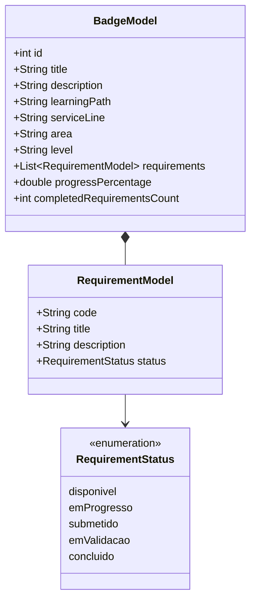
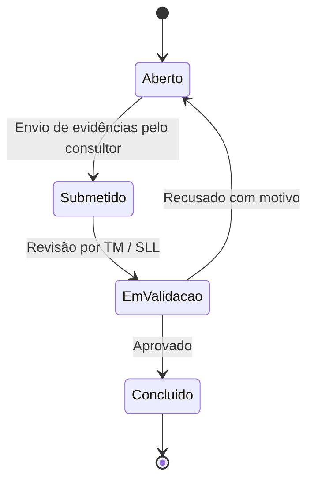

# Arquitetura da Aplicação Móvel - SoftBadge

Este documento descreve a organização de pastas, responsabilidades dos módulos e fluxos principais da aplicação móvel (`PINT26_MOBILE`), orientada para o perfil de Consultor. A aplicação foi construída em Flutter com gestão de estado em Riverpod e persistência local em SQLite (`sqflite`).

---

## 1. Estrutura do Diretório `lib/`

```text
lib/
├── main.dart                          # Ponto de entrada, tema, rotas e inicialização do ProviderScope
├── config/
│   └── api_config.dart                # Configuração do endereço base da API e cabeçalhos HTTP
├── models/                            # Modelos de dados e serialização JSON
│   ├── badge_model.dart               # Badge, requisitos individuais e cálculo de progresso
│   ├── evidence_model.dart            # Evidências submetidas (descrição, ficheiros e links)
│   ├── status_history_model.dart      # Histórico de estados e feedback de avaliação
│   ├── timeline_model.dart            # Registos do percurso do consultor
│   └── user_model.dart                # Perfil do consultor, pontos e estado da sessão
├── riverpood/                         # Providers e StateNotifiers (Riverpod)
│   ├── auth_notifier.dart             # Sessão, login automático (SQLite), troca de password e área
│   ├── badge_notifier.dart            # Catálogo de badges, filtros e métricas de progresso
│   └── language_state.dart            # Idioma ativo da aplicação
├── services/                          # Comunicação com a API, base de dados local e utilitários
│   ├── api_service.dart               # Pedidos REST (listagens, candidaturas, submissão de evidências)
│   ├── auth_service.dart              # Login, recuperação de conta e alteração de password
│   ├── basededados.dart               # Base de dados SQLite local (sessão e fila de sincronização)
│   ├── firebase_messaging_service.dart# Receção de notificações push (FCM)
│   ├── gamification_service.dart      # Cálculo de pontuação, níveis e desafios
│   ├── notification_service.dart      # Notificações locais e lembretes de expiração
│   └── pdf_service.dart               # Geração de certificados em PDF
├── screens/                           # Ecrãs da aplicação
│   ├── auth/                          # Login, alteração de password no 1.º acesso e seleção de área
│   ├── catalog/                       # Catálogo de badges, detalhe e formulário de evidências
│   ├── dashboard/                     # Painel principal, progresso e linha temporal
│   ├── history/                       # Histórico de candidaturas e estados de validação
│   ├── profile/                       # Perfil do utilizador, definições, FAQ e sobre
│   └── Sharing/                       # Partilha pública de badges e pré-visualização de certificados
├── utils/                             # Funções auxiliares e localização
└── widgets/                           # Componentes visuais reutilizáveis
```

---

## 2. Modelos e Hierarquia de Dados

Os *badges* organizam-se segundo a hierarquia:
`Learning Path > Service Line > Área > Nível > Requisitos individuais`



---

## 3. Fluxo de Submissão e Estados de Candidatura

A candidatura a um *badge* requer a submissão de evidências por requisito (descrição textual, anexos em PDF/imagem ou ligações externas). O ciclo de vida segue os estados abaixo:



- **Aberto:** Requisito disponível ou com feedback corretivo após recusa, permitindo nova submissão.
- **Submetido:** Evidências enviadas e bloqueadas para edição enquanto aguardam análise.
- **Em Validação:** Candidatura em avaliação pelo Talent Manager ou Service Line Leader.
- **Concluído:** Requisito/badge aprovado, com atribuição dos respetivos pontos e emissão de certificado.

---

## 4. Persistência Local e Estado

- **Riverpod (`StateNotifier`):** Separa a gestão de estado da camada de interface, mantendo os ecrãs reativos a alterações na sessão, idioma ou filtros do catálogo.
- **SQLite (`basededados.dart`):** Mantém a sessão ativa entre utilizações e apoia o armazenamento local de dados do consultor.
