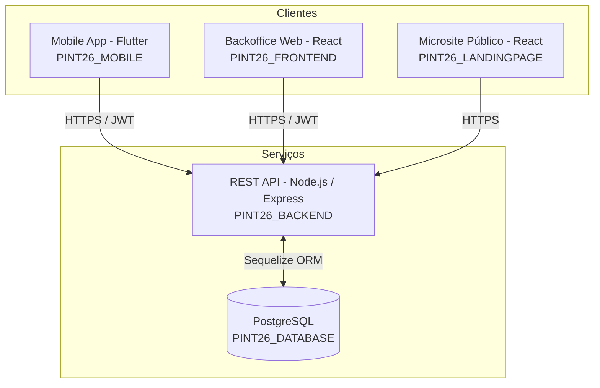

# SoftBadge - Plataforma de Badges e Gamificação

Plataforma de gestão de competências, progressão técnica e gamificação corporativa, desenvolvida no âmbito da unidade curricular de Projeto Integrado (PINT) na Escola Superior de Tecnologia e Gestão de Viseu (ESTGV - UPV), a partir de um caso de estudo proposto pela Softinsa.

## Enquadramento

O projeto tem como objetivo apoiar o acompanhamento de percursos formativos (*learning paths*) e a validação de competências técnicas e transversais dentro de uma organização. Em vez de folhas de cálculo ou registos dispersos, centraliza o catálogo de *badges*, a submissão de evidências pelos consultores e o fluxo de aprovação por parte dos responsáveis de equipa e de linha de serviço.

## Arquitetura

O repositório está organizado como *monorepo* e divide-se em cinco módulos:



```text
PINT_SOFTBADGE/
├── PINT26_MOBILE/       # Aplicação móvel Android/iOS (Flutter / Dart)
├── PINT26_FRONTEND/     # Portal web de gestão e backoffice (React / Vite)
├── PINT26_LANDINGPAGE/  # Microsite público e validação de certificados (React / Vite)
├── PINT26_BACKEND/      # API REST, lógica de negócio e notificações (Node.js / Express)
├── PINT26_DATABASE/     # Esquema relacional PostgreSQL (DDL)
└── docs/                # Relatório técnico, especificação e diagramas
```

## Funcionalidades por Módulo

### Aplicação Móvel (`PINT26_MOBILE`)
Orientada para o perfil de Consultor:
- Painel com pontuação acumulada, progresso nos objetivos, *ranking* e alertas de *badges* próximos da data de expiração.
- Consulta do catálogo de *learning paths*, linhas de serviço e áreas técnicas.
- Submissão de candidaturas a *badges* com envio de comprovativos (ficheiros ou ligações externas) e acompanhamento do histórico de avaliação (estados e motivos de recusa).
- Geração de certificados em PDF e partilha pública de *badges* com controlo de consentimento RGPD.
- Suporte para Português, Inglês e Espanhol (`l10n`) e cache local em SQLite.

### Portal Web (`PINT26_FRONTEND`)
Interface adaptada a quatro perfis (`ADMIN`, `SLL` - Service Line Leader, `TM` - Talent Manager e `CON` - Consultor):
- Gestão de utilizadores, linhas de serviço, áreas, *learning paths*, marcos e catálogo de *badges*.
- Fluxo de avaliação em duas fases: pré-validação pelo Talent Manager e aprovação final pelo Service Line Leader.
- Monitorização de tempos de resposta (SLA), métricas de conclusão e fórum interno de avisos.
- Suporte multi-idioma (PT/EN/ES) e tema claro/escuro.

### Microsite Público (`PINT26_LANDINGPAGE`)
- Página de apresentação da plataforma, consulta de perfis públicos autorizados pelo utilizador e verificação de autenticidade de certificados emitidos.

### Backend (`PINT26_BACKEND`)
- API REST em Node.js e Express com ORM Sequelize sobre PostgreSQL.
- Autenticação via JWT, *hashing* de palavras-passe com Argon2 e fluxos de primeiro acesso e recuperação de conta por código enviado por email.
- Notificações em tempo real (Socket.IO e Firebase Cloud Messaging) e geração de relatórios/certificados (PDFKit e ExcelJS).

## Tecnologias

| Módulo | Stack principal |
| :--- | :--- |
| **Mobile** | Flutter 3, Dart, Riverpod, SQLite (`sqflite`), `fl_chart`, `pdf`, `intl` |
| **Frontend Web** | React 19, Vite, Axios, `i18next`, SweetAlert2 |
| **Microsite** | React 19, Vite, Bootstrap 5, Lucide React |
| **Backend** | Node.js, Express 5, Sequelize, PostgreSQL (`pg`), Argon2, JWT, Socket.IO, Multer, Nodemailer |
| **Base de Dados** | PostgreSQL 14+ |

## Execução Local

### Pré-requisitos
- Node.js 18+ e npm
- PostgreSQL 14+
- Flutter SDK 3.x

### 1. Base de Dados
Criar a base de dados e importar o esquema inicial:
```sql
CREATE DATABASE softbadge;
```
```bash
psql -U postgres -d softbadge -f PINT26_DATABASE/schema.sql
```

### 2. Backend
```bash
cd PINT26_BACKEND
npm install
cp .env.example .env
# Ajustar as credenciais de PostgreSQL e JWT no ficheiro .env
npm run dev
```
O servidor arranca por predefinição em `http://localhost:3000`.

### 3. Frontend Web
```bash
cd PINT26_FRONTEND
npm install
npm run dev
```
Disponível em `http://localhost:3001`.

### 4. Microsite
```bash
cd PINT26_LANDINGPAGE
npm install
npm run dev
```
Disponível em `http://localhost:3002`.

### 5. Aplicação Móvel
```bash
cd PINT26_MOBILE
flutter pub get
flutter gen-l10n
flutter run
```
Nota: ajustar o endereço da API em `lib/config/api_config.dart` caso o backend esteja a correr localmente (ex.: `http://10.0.2.2:3000` em emulador Android).
